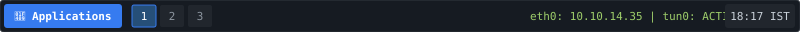
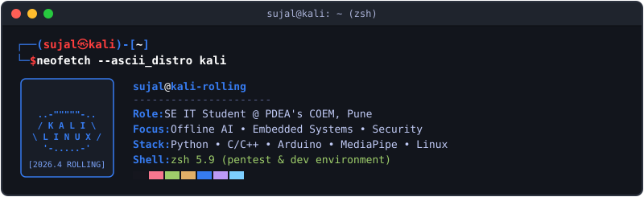

  
    
  

 

### ⚡ `/usr/bin/arsenal`

  
  
  
  
  
  
  

---

### 📂 `~/repositories/active_targets`

| Target | Payload / Description | Primary Stack |
| :--- | :--- | :--- |
| 🔹 **[hand-gesture-plaything](https://github.com/sujalraghoji0001-lang/hand-gesture-plaything)** | Real-time 20,000-particle GPU morphing engine with MediaPipe hand tracking & GLSL shaders | `JavaScript` |
| 🔹 **[STTS2611](https://github.com/sujalraghoji0001-lang/STTS2611)** | End-to-end Kaggle notebook & workflow for fine-tuning StyleTTS 2 voice models | `Jupyter Notebook` |

---

### 📡 `netstat -tulnp` (GitHub Telemetry)

  

---

### 🔗 `/etc/hosts`

